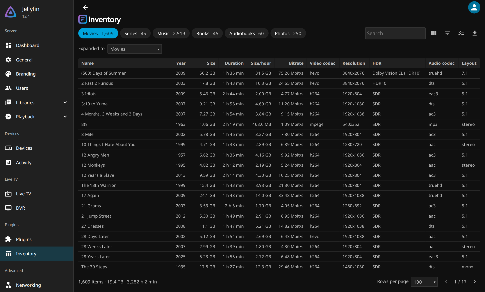
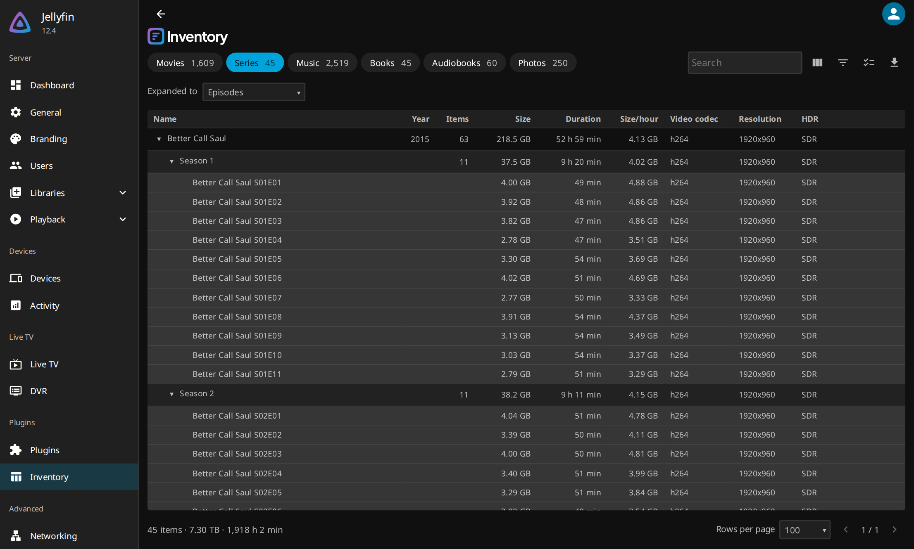

<div align="center">

<picture>
  <source media="(prefers-color-scheme: dark)" srcset=".github/assets/jellyfin_inventory-logo-on-dark.svg">
  <source media="(prefers-color-scheme: light)" srcset=".github/assets/jellyfin_inventory-logo-on-light.svg">
  
</picture>

<a href="https://inventory.ivenos.de"><picture><source media="(prefers-color-scheme: dark)" srcset="https://shieldcn.dev/badge/Try_the_demo.svg?variant=secondary&amp;mode=dark&amp;logo=data%3Aimage%2Fsvg%2Bxml%3Bbase64%2CPHN2ZyB4bWxucz0iaHR0cDovL3d3dy53My5vcmcvMjAwMC9zdmciIHZpZXdCb3g9IjAgMCAyNCAyNCI%2BPHBhdGggZD0iTTUgNWEyIDIgMCAwIDEgMy4wMDgtMS43MjhsMTEuOTk3IDYuOTk4YTIgMiAwIDAgMSAuMDAzIDMuNDU4bC0xMiA3QTIgMiAwIDAgMSA1IDE5eiIvPjwvc3ZnPg%3D%3D&amp;logoColor=00A4DC"></picture></a>
<a href="#installation"><picture><source media="(prefers-color-scheme: dark)" srcset="https://shieldcn.dev/badge/Jellyfin-12.0%2B.svg?variant=secondary&amp;mode=dark&amp;logo=jellyfin"></picture></a>
<a href="https://github.com/ivenos/jellyfin_inventory/releases"><picture><source media="(prefers-color-scheme: dark)" srcset="https://shieldcn.dev/github/downloads/ivenos/jellyfin_inventory.svg?variant=secondary&amp;mode=dark"></picture></a>
<a href="LICENSE"><picture><source media="(prefers-color-scheme: dark)" srcset="https://shieldcn.dev/badge/license-GPL_3.0.svg?variant=secondary&amp;mode=dark"></picture></a>


Inventory is a Jellyfin plugin that puts everything in your libraries into one sortable, searchable and filterable table in the dashboard, from a whole series down to a single episode.




</div>

---


## Features

- Where the space has gone: size, size per hour and bitrate.
- What files are made of: codecs, resolution, HDR, audio and subtitles.
- Titles kept twice, and items in several versions.
- Export as CSV or ODS.
- Picked rows into a collection or playlist, or out again.
- Tab, search, filters and sort order in the page address.

## Installation

Requires Jellyfin 12.0 or newer. Older servers do not list this plugin.

1. Add this repository under Dashboard → Plugins → Manage Repositories → New Repository, with any name:
   ```
   https://raw.githubusercontent.com/ivenos/jellyfin_inventory/main/manifest.json
   ```
2. Install the Inventory plugin from the catalog, under General, and restart Jellyfin.
3. Open the Inventory page under Plugins in the dashboard sidebar.

Manual install: unpack the [latest release](https://github.com/ivenos/jellyfin_inventory/releases/latest) into `plugins/Inventory` in Jellyfin's data directory (`/config/plugins` in Docker).

## Columns

| Group | Columns |
| --- | --- |
| General | Name, Series, Season, Episode, Year, Genres, Collections, Playlists, Artists, Authors, Narrators, Library, Items, Duplicates, Container, Size, Duration, Size/hour, Bitrate, Date added, Path |
| Video | Video codec, Profile, Resolution, Quality, Height, Video bitrate, Framerate, Bit depth, HDR, Dolby Vision, Pixel format, Interlaced |
| Audio | Audio codec, Layout, Channels, Audio bitrate, Sample rate, Spatial, Audio tracks, Audio languages |
| Subtitles | Subtitle tracks, Subtitle languages |
| Playback | Last played, Last played (all users), Plays, Plays (all users), Fully played, Fully played by |

- Name sorts by the sort title, else without a leading The, A or An.
- `SortRemoveWords` in the server's `system.xml` changes these words.
- Each tab offers the columns it can fill, plus any chosen before.
- A filter on a column the tab cannot fill is dimmed there and does not apply.
- A search shows the show, album or book in front of what it finds below them.
- Films, episodes, music videos and videos in several versions open to them.
- Where versions differ, a row shows Mixed.
- Where quality differs, a row shows the lowest with a plus, such as 720p+.
- HDR shows SDR, HDR10, HDR10+, HLG or Dolby Vision, with the layer Dolby Vision falls back on in brackets.
- Duplicates counts other items of the tab with the same title.

<details>
<summary>Columns per tab and duplicates in detail</summary>

- Series, Season and Episode: Series only.
- Artists: Music and Music videos only.
- Authors and Narrators: Books and Audiobooks only.
- Books and Photos: no Playlists, Items, Duration, Size/hour, Bitrate, audio, video or subtitle columns.
- Photos keep Resolution and Height.
- Music and Audiobooks: no video or subtitle columns.
- Books, Audiobooks and Photos: no Duplicates.
- Duplicates matches films, series, music videos and videos by TMDb, IMDb or TheTVDB id.
- Albums and tracks by MusicBrainz id.
- Seasons and episodes by their number in the same show.
- Versions of one item do not count. Items without an id stay empty.

</details>

## API

<details>
<summary>Endpoints and parameters</summary>

- Base path `/Inventory`, with an administrator token.
- An API key has no user: Playlists, Last played, Plays and Fully played stay empty, and it changes no playlist.
- `mediaType` names a tab, `level` a level in it. Default: the level the tab is named after.
- For `AudioBook` that level is its files. The books are `Folder`.
- Media types, levels and column keys come from `Schema`.

| Endpoint | Parameters | Returns |
| --- | --- | --- |
| `GET Schema` | `culture` | Media types with their levels, how far each opens and what their rows can go into; columns with their media types, operators and, for quality, classes in order; page size; most conditions `filters` may carry; interface strings and their culture |
| `GET Items` | `mediaType`, `level`, `parentIds`, `columnLevel`, `search`, `filters`, `sortBy`, `descending`, `startIndex`, `limit`, `culture` | One page of rows, their columns, the total count, size and runtime; with `parentIds` all children, unpaged |
| `GET Export` | `mediaType`, `level`, `columnLevel`, `format`, `search`, `filters`, `sortBy`, `descending`, `culture` | Every matching row as `csv` or `ods`, less those a match above already covers |
| `POST Columns` | `level`, column keys as a JSON array in the body | The stored selection |
| `POST Expand` | `mediaType`, `level` | The stored level |
| `POST PageSize` | `size` | The stored rows per page |
| `GET Targets` | | Every collection, and the playlists the user owns or may edit, with id and name |
| `POST Targets` | The change as a JSON object in the body | The target, how many entries it gained or lost, how many items could not go in |
| `POST Targets/Held` | The `Ids` and `All` of `POST Targets`, in the body | Collections holding any of the items, the user's playlists holding what they play |

Filters:

- `filters` is a JSON array of up to 20 conditions, all must hold: `[{"column":"height","op":"ge","value":1080}]`.
- `op` is one the column lists in `Schema`: `eq`, `ne`, `ge`, `le`, `contains`, `notContains`, `empty`, `notEmpty`.
- `empty` and `notEmpty` take no `value`.
- Values are in the unit `Items` answers in: bytes, bytes per hour, seconds, bits per second.
- Dates as `yyyy-MM-dd`, truth values as `true` or `false`.
- A quality is one of the classes in `Schema`, compared by its place there.
- In a `List` column, `eq` and `ne` check each value on its own.
- An empty cell meets only `ne`, `notContains` and `empty`.
- A Mixed cell meets no condition.
- A quality such as 720p+ meets `notEmpty`, and `ge` up to its lowest class.

Search and export:

- `search` matches part of a name, series, path, artist, author or narrator.
- On the outermost level it reaches every level of the tab.
- A row it finds below the top level names its show, album or book in `Within`, unless its own name starts with it.
- `Export` then leaves out a row whose series, season, album or book matched too.
- Level `Version` lists every file of a tab: an item in one file once, one in several once per version.
- A version is named after its item plus what its file name adds.
- A `csv` names the unit in its header and takes its separators from `culture`. An `ods` types its cells.
- The page address takes `mediaType`, `search`, `filters`, `sortBy` and `descending`.
- A condition on a column the tab cannot fill stays in the address but is not sent.

Collections and playlists:

- `POST Targets` takes `Kind` (`Collection` or `Playlist`), `Remove` (`true` or `false`) and the item ids in `Ids`.
- Plus the `Id` of an existing target or, when adding, the `Name` of a new one.
- A name cannot start with a dot or hold a character Jellyfin cannot save.
- A new collection with the name or folder name of an existing one goes into that one.
- A new target none of the items can go into is refused with 422.
- `All` adds every row of a listing, given by `MediaType`, `Level`, `Search` and `Filters`.
- Ids in `Except` leave out only themselves.
- `All` leaves out a row whose series, season, album or book matched too.
- A version goes in and out as the item it belongs to.
- A collection holds what is picked.
- A playlist holds the episodes, tracks or files of a picked series, album or audiobook, in the order of their tab, each once, none from `Except`.
- Tracks and photos go into no collection, photos and e-books into no playlist.

</details>

## License

Copyright © Iven Schlösser. The Inventory plugin is free software, licensed under the [GNU General Public License v3.0 only](LICENSE). You may use, modify and redistribute it. Anyone distributing a modified version must release it under the same license and make its source code available.

It builds on the Jellyfin.Controller and Jellyfin.Model packages, licensed under the GNU General Public License v3.0 only. The title of its dashboard page is set in Plus Jakarta Sans, whose Latin letters it embeds under the SIL Open Font License 1.1.

The Inventory plugin is not affiliated with or endorsed by the Jellyfin project.
